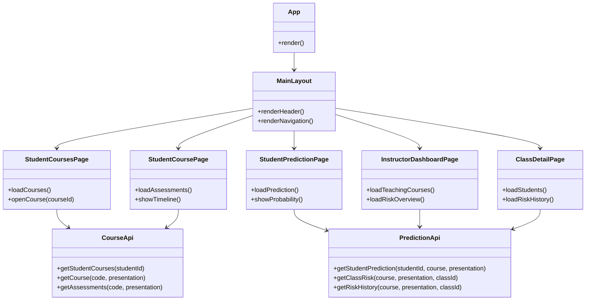

# Performance Prediction Extension

> Hệ thống extension dự đoán nguy cơ sinh viên bị điểm liệt trong một `course/module`, sử dụng dữ liệu OULAD đã được tùy biến. Hệ thống được thiết kế theo **Layered Architecture kết hợp Service-Based Architecture (Modular Monolith)**, gồm Frontend (React), Backend (Python), Database (CSV) và Prediction (Python).

---

# I. Context dự án

## 1. Mục tiêu

Xây dựng một extension có thể tích hợp vào LMS của nhà trường để cung cấp thông tin dự báo nguy cơ sinh viên bị điểm liệt theo tiến trình học tập của từng học kỳ.

Các chức năng LMS cơ bản như đăng bài, nộp bài, chấm điểm và quản lý nội dung khóa học được giả định là đã tồn tại. Extension chỉ phụ trách đọc dữ liệu cần thiết, phân tích tiến độ và hiển thị kết quả dự báo.

### Student

- Xem danh sách các `course/module` đang học hoặc đã học.
- Xem các hoạt động/assessment của một học kỳ theo trình tự thời gian.
  - Học kỳ đang diễn ra: chỉ hiển thị hoạt động đến thời điểm hiện tại.
  - Học kỳ đã kết thúc: hiển thị toàn bộ hoạt động.
- Mở trang điểm số/dự báo của môn học để xem xác suất bị điểm liệt sau khi đã tham gia `n` hoạt động tính điểm.

### Instructor

- Chỉ xem được các lớp/học kỳ thuộc môn học được phân công.
- Xem tổng quan hội đồng môn (`code_module + code_presentation`): số sinh viên có nguy cơ bị điểm liệt trên tổng số sinh viên.
- Xem danh sách sinh viên theo từng lớp/học kỳ.
- Xem xác suất nguy cơ của từng sinh viên theo các mốc thời gian.
- Xem xu hướng nguy cơ của toàn lớp theo thời gian để hỗ trợ nhắc nhở và điều chỉnh hoạt động giảng dạy.

## 2. Dữ liệu đầu vào

Các file CSV là nguồn dữ liệu đầu vào cho phiên bản prototype. Trong triển khai thật, chúng có thể được thay thế bằng adapter đọc dữ liệu từ LMS/DB của trường mà không phải thay đổi các service nghiệp vụ.

| File | Vai trò | Các cột chính |
|---|---|---|
| `Student_class_assignment.csv` | Ánh xạ sinh viên vào lớp/học kỳ | `code_module`, `code_presentation`, `id_student`, `date_registration`, `registration_rank`, `class_id` |
| `StudentAssetment.csv` | Kết quả assessment của sinh viên | `id_assessment`, `id_student`, `date_submitted`, `is_banked`, `score` |
| `class_instructor.csv` | Phân công giảng viên | `code_module`, `code_presentation`, `class_id`, `instructor_id` |
| `courses.csv` | Thông tin học kỳ của môn học | `code_module`, `code_presentation`, `module_presentation_length` |
| `assessments.csv` | Danh sách assessment | `code_module`, `code_presentation`, `id_assessment`, `assessment_type`, `date`, `weight` |

**Lưu ý về dữ liệu:**

- Tên file trong code nên được chuẩn hóa thống nhất, ví dụ dùng `student_assessment.csv` thay cho các biến thể `StudentAssetment.csv`/`studentAssessment.csv`.
- Cần kiểm tra schema thực tế trước khi chạy: tên cột, kiểu dữ liệu, khóa liên kết và giá trị thiếu.
- `score` là điểm đã được ghi nhận; không được dùng điểm của assessment trong tương lai để tạo feature cho một mốc dự báo quá khứ (tránh data leakage).
- Ngưỡng “điểm liệt” phải được cấu hình theo quy định của môn/trường. Không nên mặc định một ngưỡng chung nếu quy chế chưa xác định.
- Các file hiện tại không thể hiện đầy đủ mọi hoạt động LMS (ví dụ lượt xem tài liệu/VLE). Nếu muốn hiển thị hoặc dự báo dựa trên hoạt động đó, cần bổ sung nguồn dữ liệu tương ứng.

## 3. Quy ước dự báo

Một bản ghi dự báo nên gắn với tối thiểu:

`student_id + code_module + code_presentation + class_id + cutoff_date`

Output đề xuất:

| Field | Ý nghĩa |
|---|---|
| `student_id` | Mã sinh viên |
| `code_module` | Mã môn/course |
| `code_presentation` | Mã kỳ/presentation |
| `class_id` | Mã lớp |
| `cutoff_date` | Ngày chốt dữ liệu dùng để dự báo |
| `n_assessments` | Số assessment đã có kết quả tại cutoff |
| `fail_probability` | Xác suất bị điểm liệt, trong khoảng 0–1 |
| `risk_level` | `LOW`, `MEDIUM`, `HIGH` |
| `model_version` | Phiên bản mô hình |
| `generated_at` | Thời điểm tạo dự báo |

Ví dụ minh họa: `fail_probability = 0.82` tương ứng nguy cơ bị điểm liệt 82%. Đây là xác suất do mô hình ước lượng, không phải kết quả điểm cuối cùng.

---

# II. Kiến trúc dự án

## 1. Tổng quan

Dự án sử dụng **Layered Architecture + Service-Based modules**:

- **Frontend – React:** giao diện Student/Instructor và biểu đồ dự báo.
- **Backend – Python (FastAPI):** API, xác thực/phân quyền, điều phối nghiệp vụ.
- **Database – CSV:** repository đọc dữ liệu CSV trong prototype; folder được tách riêng để sau này thay bằng database thật.
- **Prediction – Python:** feature engineering, nạp model và inference; tách khỏi backend nghiệp vụ.

Ở phạm vi nhóm 2 người, nên triển khai backend dưới dạng **modular monolith**: các service được tách module và có interface rõ ràng nhưng chạy trong cùng một backend process. Chưa cần triển khai microservices độc lập.

## 2. Cấu trúc thư mục đề xuất

```text
performance_prediction/
│
├── README.md
├── .env.example
├── .gitignore
│
├── frontend/                         # React + Vite
│   ├── package.json
│   ├── index.html
│   └── src/
│       ├── main.jsx
│       ├── App.jsx
│       ├── api/
│       │   ├── httpClient.js
│       │   ├── courseApi.js
│       │   └── predictionApi.js
│       ├── components/
│       │   ├── CourseCard.jsx
│       │   ├── RiskBadge.jsx
│       │   ├── ProbabilityChart.jsx
│       │   └── AssessmentTimeline.jsx
│       ├── pages/
│       │   ├── StudentCoursesPage.jsx
│       │   ├── StudentCoursePage.jsx
│       │   ├── StudentPredictionPage.jsx
│       │   ├── InstructorDashboardPage.jsx
│       │   └── ClassDetailPage.jsx
│       ├── layouts/
│       │   └── MainLayout.jsx
│       └── styles/
│           └── global.css
│
├── backend/                          # Python + FastAPI
│   ├── requirements.txt
│   └── app/
│       ├── main.py                   # Khởi tạo FastAPI và đăng ký routers
│       ├── core/
│       │   ├── config.py             # Đọc biến môi trường
│       │   └── exceptions.py
│       ├── presentation/             # API / Controller layer
│       │   ├── routes/
│       │   │   ├── course_routes.py
│       │   │   ├── assessment_routes.py
│       │   │   ├── prediction_routes.py
│       │   │   └── instructor_routes.py
│       │   └── schemas/
│       │       ├── course_schema.py
│       │       └── prediction_schema.py
│       ├── services/                 # Service layer
│       │   ├── course_service.py
│       │   ├── assessment_service.py
│       │   ├── prediction_service.py
│       │   ├── instructor_service.py
│       │   └── risk_aggregation_service.py
│       ├── domain/                   # Entity / business rules
│       │   ├── models/
│       │   │   ├── course.py
│       │   │   ├── assessment.py
│       │   │   ├── student.py
│       │   │   └── prediction.py
│       │   └── policies/
│       │       └── risk_policy.py
│       ├── infrastructure/           # Data access / external adapters
│       │   ├── repositories/
│       │   │   ├── course_repository.py
│       │   │   ├── student_repository.py
│       │   │   ├── assessment_repository.py
│       │   │   └── prediction_repository.py
│       │   └── adapters/
│       │       └── csv_data_adapter.py
│       └── dependencies.py           # Dependency wiring
│
├── database/                         # CSV data source (prototype)
│   ├── raw/
│   │   ├── Student_class_assignment.csv
│   │   ├── StudentAssetment.csv
│   │   ├── class_instructor.csv
│   │   ├── courses.csv
│   │   └── assessments.csv
│   └── predictions/                  # Prediction output CSV (nếu lưu file)
│
├── prediction/                       # Python ML pipeline (tách biệt)
│   ├── models/                       # Model artifacts, ví dụ .json/.pkl
│   ├── features/                     # Feature engineering
│   ├── inference/                    # Hàm predict dùng bởi PredictionService
│   ├── training/                     # Script train/evaluate
│   └── README.md
│
└── tests/
    ├── backend/
    └── frontend/
```

Các script hiện có như `features.py`, `features_common.py`, `predict_progress.py`, `train.py`, `train_cls.py`, `feature_sets/`, `predict/`, `predict_xai/`, `results_cls/` nên được giữ trong `prediction/` hoặc được di chuyển dần vào các module tương ứng. Không cần viết lại toàn bộ pipeline ngay từ đầu; hãy tạo một interface inference ổn định để backend gọi pipeline hiện tại.

## 3. Class architecture – Frontend

Frontend dùng component-based architecture. Các page gọi API thông qua `api/`, không đọc CSV và không gọi trực tiếp model.



**Trách nhiệm chính:**

- `StudentCoursesPage`: danh sách môn đang học/đã học.
- `StudentCoursePage`: timeline assessment theo ngày; học kỳ hiện tại giới hạn theo ngày hiện tại, học kỳ cũ hiển thị toàn bộ.
- `StudentPredictionPage`: hiển thị xác suất nguy cơ của chính sinh viên và các mốc dự báo.
- `InstructorDashboardPage`: tổng quan các môn/học kỳ được phân công và tỷ lệ sinh viên nguy cơ cao.
- `ClassDetailPage`: danh sách sinh viên, xác suất từng sinh viên và xu hướng nguy cơ của lớp.
- `RiskBadge`, `ProbabilityChart`, `AssessmentTimeline`: component hiển thị dùng lại ở nhiều page.

## 4. Class architecture – Backend

Backend chia thành các layer. Dependency chỉ đi từ layer phía trên xuống abstraction/service phía dưới; frontend chỉ giao tiếp với backend qua HTTP API.

```mermaid
classDiagram
    class CourseRoutes {
      +getStudentCourses(studentId)
      +getCourse(codeModule, presentation)
      +getAssessments(codeModule, presentation)
    }
    class PredictionRoutes {
      +getStudentPrediction(studentId, codeModule, presentation)
      +getClassRisk(codeModule, presentation, classId)
      +getRiskHistory(codeModule, presentation, classId)
    }
    class InstructorRoutes {
      +getTeachingCourses(instructorId)
      +getClassStudents(instructorId, codeModule, presentation, classId)
    }

    class CourseService {
      +getStudentCourses(studentId)
      +getCourseTimeline(codeModule, presentation, currentDate)
    }
    class AssessmentService {
      +getAssessments(codeModule, presentation, currentDate)
      +getCompletedAssessmentCount(studentId, codeModule, presentation, cutoff)
    }
    class PredictionService {
      +predictStudentRisk(studentId, course, presentation, cutoff)
      +getPredictionHistory(studentId, course, presentation)
    }
    class InstructorService {
      +getTeachingCourses(instructorId)
      +getClassStudents(instructorId, course, presentation, classId)
    }
    class RiskAggregationService {
      +calculateClassRisk(course, presentation, classId, cutoff)
      +calculateCourseRisk(course, presentation, cutoff)
      +buildRiskTrend(course, presentation, classId)
    }

    class CourseRepository {
      +findStudentCourses(studentId)
      +findCourse(codeModule, presentation)
    }
    class StudentRepository {
      +findStudentsByClass(classId)
      +findStudent(studentId)
      +findInstructorAssignments(instructorId)
    }
    class AssessmentRepository {
      +findAssessments(course, presentation)
      +findStudentScores(studentId, course, presentation)
    }
    class PredictionRepository {
      +findLatestPrediction(studentId, course, presentation)
      +findPredictionHistory(course, presentation, classId)
      +savePredictions(records)
    }
    class CsvDataAdapter {
      +readCsv(fileName)
      +validateSchema()
    }
    class PredictionEngine {
      +buildFeatures(input, cutoff)
      +predictProbability(features)
      +explainPrediction(features)
    }

    CourseRoutes --> CourseService
    CourseRoutes --> AssessmentService
    PredictionRoutes --> PredictionService
    PredictionRoutes --> RiskAggregationService
    InstructorRoutes --> InstructorService
    InstructorRoutes --> RiskAggregationService

    CourseService --> CourseRepository
    CourseService --> AssessmentRepository
    AssessmentService --> AssessmentRepository
    PredictionService --> AssessmentRepository
    PredictionService --> PredictionRepository
    PredictionService --> PredictionEngine
    InstructorService --> StudentRepository
    InstructorService --> CourseRepository
    RiskAggregationService --> PredictionRepository
    RiskAggregationService --> StudentRepository

    CourseRepository --> CsvDataAdapter
    StudentRepository --> CsvDataAdapter
    AssessmentRepository --> CsvDataAdapter
    PredictionRepository --> CsvDataAdapter
```



### Trách nhiệm của từng layer

| Layer | Thành phần | Trách nhiệm |
|---|---|---|
| Presentation | FastAPI routes, request/response schemas | Nhận HTTP request, validate input, trả JSON; không chứa logic ML |
| Service | `CourseService`, `PredictionService`, ... | Điều phối nghiệp vụ, kết hợp repository và prediction engine |
| Domain | Student, Course, Assessment, Prediction, RiskPolicy | Quy tắc nghiệp vụ và mô hình dữ liệu độc lập framework |
| Infrastructure | CSV repositories, adapter, model adapter | Đọc/ghi CSV, kết nối nguồn dữ liệu và gọi pipeline ML |

### Các service nghiệp vụ

- **CourseService:** lấy danh sách course của sinh viên; lấy thông tin môn và timeline assessment.
- **AssessmentService:** lấy assessment, xác định assessment đã diễn ra và số hoạt động đã có điểm tại một cutoff.
- **PredictionService:** lấy dữ liệu đến cutoff, tạo feature và gọi `PredictionEngine`; trả xác suất nguy cơ của sinh viên.
- **InstructorService:** kiểm tra phân công giảng viên và trả về các lớp/học kỳ mà instructor được phép xem.
- **RiskAggregationService:** tính số lượng/tỷ lệ sinh viên nguy cơ theo lớp hoặc toàn course/presentation; tổng hợp lịch sử để vẽ biểu đồ.

### Luồng dự báo

1. Frontend gửi yêu cầu xem dự báo kèm `student_id`, `code_module`, `code_presentation` và `cutoff_date`.
2. Route kiểm tra request và chuyển cho `PredictionService`.
3. Service lấy thông tin đăng ký, assessment và điểm đã ghi nhận đến cutoff từ repositories.
4. `PredictionEngine` tạo feature theo đúng cutoff và chạy model đã huấn luyện.
5. `PredictionService` lưu hoặc đọc kết quả qua `PredictionRepository`.
6. Route trả JSON cho frontend hiển thị xác suất và mức nguy cơ.

**Quan trọng:** Nếu model được train sẵn và backend chỉ inference, không chạy huấn luyện model trong mỗi HTTP request. Training là tác vụ offline riêng; inference mới là tác vụ phục vụ người dùng.

## 5. API dự kiến

| Method | Endpoint | Mục đích |
|---|---|---|
| GET | `/api/students/{student_id}/courses` | Course sinh viên đang học/đã học |
| GET | `/api/courses/{code_module}/{presentation}/assessments` | Timeline assessment |
| GET | `/api/students/{student_id}/courses/{code_module}/{presentation}/prediction` | Dự báo của sinh viên |
| GET | `/api/instructors/{instructor_id}/courses` | Course được phân công |
| GET | `/api/courses/{code_module}/{presentation}/classes/{class_id}/students` | Danh sách sinh viên lớp |
| GET | `/api/courses/{code_module}/{presentation}/classes/{class_id}/risk` | Tổng quan tỷ lệ nguy cơ của lớp |
| GET | `/api/courses/{code_module}/{presentation}/classes/{class_id}/risk-history` | Xu hướng nguy cơ theo thời gian |

Đây là API contract định hướng. Cần triển khai route tương ứng trước khi frontend gọi được endpoint đó.

---

# III. How to run

Phần này mô tả cách chạy prototype local trên Windows PowerShell. Yêu cầu:

- Python 3.11 trở lên.
- Node.js 20 trở lên và npm.
- Git (nếu clone source).
- CSV đầu vào được đặt trong `database/raw/`.

> **Lưu ý:** README này là blueprint kiến trúc và quy trình chạy. Các lệnh dưới đây giả định bạn đã tạo các file backend/frontend theo cấu trúc và API contract ở phần II; chỉ tạo folder hoặc copy CSV thì chưa đủ để hệ thống chạy. Phần Prediction có thể tạm dùng adapter/mock inference cho đến khi tích hợp model thật.

## 1. Chuẩn bị CSV (Database layer)

Đặt các file dữ liệu vào:

```text
database/raw/
├── Student_class_assignment.csv
├── StudentAssetment.csv
├── class_instructor.csv
├── courses.csv
└── assessments.csv
```

Tạo file `.env` tại thư mục gốc:

```env
DATA_DIR=../database/raw
PREDICTION_OUTPUT_DIR=../database/predictions
CORS_ORIGINS=http://localhost:5173
```

Backend nên đọc `DATA_DIR` từ biến môi trường, không hard-code đường dẫn tuyệt đối. Nếu chạy backend từ thư mục `backend/`, `../database/raw` trỏ đến folder dữ liệu ở root.

CSV không phải database có transaction/concurrency như PostgreSQL. Với prototype, chỉ nên dùng CSV làm nguồn đọc và lưu output theo batch; nếu nhiều người dùng ghi đồng thời hoặc cần cập nhật real-time, chuyển `PredictionRepository` sang PostgreSQL/MySQL mà không đổi service nghiệp vụ.

## 2. Chạy Backend (Python + FastAPI)

Mở terminal tại thư mục gốc dự án:

```powershell
cd backend

# Tạo virtual environment
py -3 -m venv .venv

# Kích hoạt virtual environment
.\.venv\Scripts\Activate.ps1

# Nếu PowerShell chặn activate, có thể chạy:
# Set-ExecutionPolicy -Scope Process -ExecutionPolicy Bypass

# Cài dependencies
python -m pip install --upgrade pip
pip install -r requirements.txt

# Chạy API server
python -m uvicorn app.main:app --reload --host 127.0.0.1 --port 8000
```

`backend/requirements.txt` tối thiểu cần có:

```text
fastapi
uvicorn[standard]
pandas
pydantic
python-dotenv
```

Khi server chạy thành công:

- API base URL: `http://127.0.0.1:8000`
- Swagger UI: `http://127.0.0.1:8000/docs`
- Health check nên được cung cấp tại: `http://127.0.0.1:8000/health`

Kiểm tra backend trước khi chạy frontend. Nếu `/docs` không mở được, kiểm tra terminal backend và import path `app.main:app`.

## 3. Chạy Frontend (React + Vite)

Mở **terminal thứ hai**, tại thư mục gốc:

```powershell
cd frontend

# Cài dependencies
npm install

# Chạy React development server
npm run dev
```

Frontend cần cấu hình API base URL, ví dụ trong `.env` của frontend:

```env
VITE_API_BASE_URL=http://127.0.0.1:8000
```

Mở URL Vite hiển thị trong terminal, mặc định:

`http://localhost:5173`

Frontend gọi backend qua `fetch`/Axios; không đọc CSV trực tiếp. Backend cần cấu hình CORS cho `http://localhost:5173`.

## 4. Kiểm tra luồng tương tác end-to-end

Thực hiện theo thứ tự:

1. Kiểm tra `http://127.0.0.1:8000/health`.
2. Mở `http://127.0.0.1:8000/docs`, thử các API đã triển khai.
3. Mở `http://localhost:5173`.
4. Chọn Student hoặc Instructor demo (nếu prototype có màn hình chọn role).
5. Student: chọn course → xem timeline assessment → mở trang Prediction.
6. Instructor: chọn course/presentation/class → xem danh sách sinh viên → xem tỷ lệ nguy cơ và biểu đồ theo thời gian.

Một response dự báo mẫu mà frontend có thể hiển thị:

```json
{
  "student_id": 123456,
  "code_module": "AAA",
  "code_presentation": "2013J",
  "class_id": "AAA-2013J-01",
  "cutoff_date": "2013-02-15",
  "n_assessments": 3,
  "fail_probability": 0.82,
  "risk_level": "HIGH",
  "model_version": "xgboost-v1",
  "generated_at": "2013-02-15T12:00:00"
}
```

Response tổng quan lớp mẫu:

```json
{
  "code_module": "AAA",
  "code_presentation": "2013J",
  "class_id": "AAA-2013J-01",
  "total_students": 100,
  "at_risk_students": 18,
  "at_risk_rate": 0.18,
  "cutoff_date": "2013-02-15"
}
```

Các giá trị trên chỉ là dữ liệu minh họa cho định dạng response, không phải kết quả thực nghiệm từ OULAD.

## 5. Tích hợp prediction pipeline hiện tại

Các script hiện có (`train.py`, `train_cls.py`, `features.py`, `features_common.py`, `predict_progress.py`, `feature_sets/`, `predict/`, `predict_xai/`) nên tiếp tục chạy độc lập để huấn luyện và đánh giá model.

Đề xuất tích hợp theo hai giai đoạn:

**Giai đoạn 1 – đọc prediction output đã sinh:**

- Chạy pipeline hiện tại để tạo file prediction CSV.
- `PredictionRepository` đọc file output theo khóa sinh viên + course + presentation + cutoff.
- Backend trả kết quả cho frontend.
- Đây là cách đơn giản nhất để demo end-to-end trước.

**Giai đoạn 2 – inference trực tiếp:**

- Tách phần tạo feature và inference thành hàm Python có interface ổn định, ví dụ `predict_student_risk(input_data, cutoff_date)`.
- `PredictionService` gọi `PredictionEngine`; engine nạp model artifact đã train.
- Không gọi script training trong request của Student/Instructor.
- Lưu prediction theo từng cutoff để có lịch sử biểu đồ.

## 6. Thứ tự chạy tóm tắt

Mỗi lần demo cần mở hai terminal:

**Terminal 1 – Backend**

```powershell
cd backend
.\.venv\Scripts\Activate.ps1
python -m uvicorn app.main:app --reload --port 8000
```

**Terminal 2 – Frontend**

```powershell
cd frontend
npm run dev
```

Sau đó truy cập `http://localhost:5173`. Backend phải tiếp tục chạy ở terminal 1 trong suốt quá trình tương tác.

---

## Ghi chú triển khai

- Prototype có thể dùng demo identity để phân biệt Student/Instructor, nhưng không được xem đây là cơ chế xác thực production.
- Khi tích hợp LMS thật, lấy `student_id`/`instructor_id` từ identity đã xác thực của LMS; không tin ID do client tự gửi để quyết định quyền truy cập.
- Instructor chỉ được xem các lớp có bản ghi phân công trong `class_instructor.csv`.
- Cần phân biệt `class_id` với `code_module + code_presentation`: một course/presentation có thể có nhiều lớp.
- Tỷ lệ nguy cơ lớp được tính theo cùng cutoff: `at_risk_students / total_students`. Phải định nghĩa rõ `at_risk_students` (ví dụ `fail_probability >= threshold`) và xử lý trường hợp không có sinh viên.
- Khi chuyển sang dữ liệu trường thật, chỉ cần thay CSV adapter/repositories bằng LMS adapter hoặc database repository, giữ nguyên các service và domain rules; tuy nhiên model phải được đánh giá lại/retrain vì phân phối dữ liệu có thể khác OULAD.
